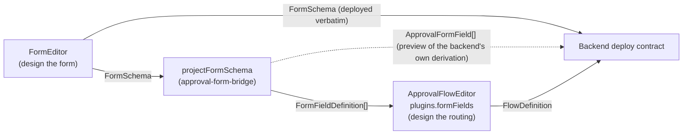

# Visual Editors

VEF ships three independent packages for designing forms and approval workflows visually instead of hand-writing schema JSON:

| Package | What it is | Consumes | Produces |
| --- | --- | --- | --- |
| [`@vef-framework-react/form-editor`](./form-editor/overview.md) | A visual form designer (`FormEditor`) plus a runtime renderer (`FormRenderer`) | — | `FormSchema` |
| [`@vef-framework-react/approval-form-bridge`](./approval-form-bridge.md) | A pure-function projection library — no editor UI | `FormSchema` | `FormFieldDefinition[]` (flow-editor field inventory) + `ApprovalFormField[]` (a designer-side preview of the backend's flat field list) + save-gate issues |
| [`@vef-framework-react/approval-flow-editor`](./approval-flow-editor/overview.md) | A visual approval-routing designer (`ApprovalFlowEditor`) | `FormFieldDefinition[]` (via `plugins.formFields`) | `FlowDefinition` |

## How they relate

An approval workflow has two halves that are designed separately and then joined: **what data is collected** (the form) and **who approves it, in what order, under what conditions** (the flow). `approval-form-bridge` is the seam between the two — it never renders anything; it only projects one schema shape into another.

1. **`form-editor`** designs the form a submitter fills out — fields, layout, and per-device presentations — as a `FormSchema`. Since v2.10.0 that rich schema is itself the deploy payload: the backend receives it verbatim and derives its flat field list server-side.
2. **`approval-form-bridge`**'s `projectFormSchema` walks that schema once and produces two things from the same walk, so they can never disagree: a `FormFieldDefinition[]` field inventory shaped for the flow editor, and the flat `ApprovalFormField[]` — a designer-side preview of exactly what the Go backend will derive at deploy, used to catch contract-fit problems early. `validateApprovalSchema` combines form-editor's structural validation with the projection's contract-fit validation into one save gate.
3. **`approval-flow-editor`** designs the routing graph — start/approval/handle/condition/cc/end nodes — as a `FlowDefinition`. It reads the projected `FormFieldDefinition[]` through `plugins.formFields` to power its condition editor and field-permission tables, and cross-checks node configuration against that same field inventory during validation.

Each package works standalone: `approval-flow-editor` only needs a `FormFieldDefinition[]` array (hand-written or sourced any other way), not the bridge specifically; `form-editor` has no dependency on the approval packages at all. The three compose into one pipeline only when a host is building an end-to-end approval-flow designer, as in `@vef-framework-react/approval-flow-editor`'s own playground wizard demo.

For a batteries-included version of that composition, the [approval engine](../engines/approval/overview.md) pages (`@vef-framework-react/approval`, v2.12.0) embed all three packages behind the engine's persistence chain — its flow-designer wizard wires the editors together and re-exports the picker contract types (`EditorPlugins`, `PickerProps`, `PrincipalKind`) from `approval-flow-editor`.

## Where to start

- Designing what a submitter fills out → [Form Editor](./form-editor/overview.md)
- Bridging a designed form to the approval backend's contract → [Approval Form Bridge](./approval-form-bridge.md)
- Designing who approves it and in what order → [Approval Flow Editor](./approval-flow-editor/overview.md)
