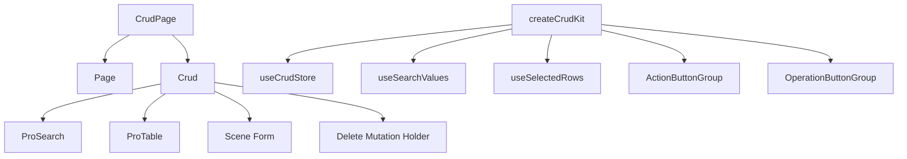

# CRUD Pages

One of the most productive parts of `@vef-framework-react/components` is the combination of `CrudPage` and `createCrudKit()`. The goal is not only to reduce table boilerplate, but to standardize search, list loading, form scenes, delete flows, batch actions, and page-local state. This page focuses on why the pieces are shaped the way they are; the full prop reference lives in [Crud and CrudPage](../components/crud.md).

## What a CRUD Page Combines



## Minimal `CrudPage` Example

```tsx
<CrudPage
  rowSelection
  basicSearch={<BasicSearch />}
  columnSettings={{ storageKey: "page.auth.user" }}
  deleteManyMutationFn={deleteUsers}
  deleteMutationFn={deleteUser}
  queryFn={findUserPage}
  renderForm={scene => <Form scene={scene} />}
  rowKey="id"
  tableColumns={tableColumns}
  formMutationFns={{
    create: createUser,
    update: updateUser
  }}
  sceneDefaultFormValues={{
    create: { isActive: true, isLocked: false }
  }}
/>
```

## When `CrudPage` Fits Best

`CrudPage` is usually a good fit when a page combines list queries, search areas, create or update forms, single-row delete, and batch operations. If the page is only a read-only table, `ProTable` on its own is often enough — see [Tables](./tables.md).

## Why `renderForm(scene)` Matters

CRUD forms rarely have only one shape. Create and update flows usually differ in small but important ways:

- password required on create but optional on update
- defaults applied only on create
- some fields disabled on update

That is why the form is rendered by scene instead of being one static form:

```tsx
renderForm={scene => <Form scene={scene} />}
```

## Why `createCrudKit()` Matters

`createCrudKit()` locks a page's own generic types into a reusable local toolkit:

```ts
import { createCrudKit } from "@vef-framework-react/components";

export const {
  useCrudStore,
  useSearchValues,
  useSelectedRows,
  OperationButtonGroup,
  ActionButtonGroup
} = createCrudKit<User, UserSearch, UserFormSceneValues>();
```

After that, search components can read strongly typed search values, toolbar buttons can access selected rows directly, and row operation columns can access `openForm`, `delete`, and `refetchQuery` without threading generics through every component that touches the page.

## Behavior Notes

Selection-clearing after `delete`/`deleteMany`, and the per-scene `formActionsRenderers` signature, are documented in full in [Crud and CrudPage](../components/crud.md).

## Reuse Strategy

The most reusable pieces are usually the page query function, the page-local `createCrudKit()` result, the search component, and the form component. This keeps pages consistent without making them overly rigid.
