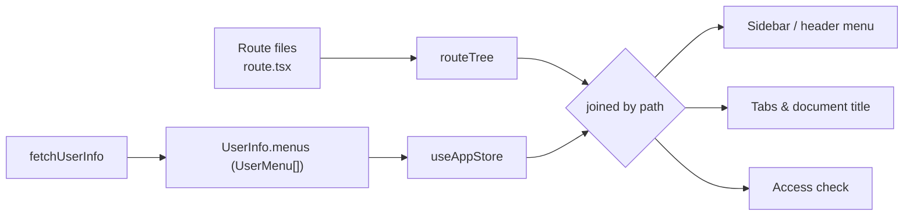

# Menus & Navigation

[Your First CRUD Page](../getting-started/first-crud-page.md) ends with a working route at `/products` — but creating the route file alone does not put it in the sidebar. This page explains where the menu actually comes from, how it joins the route tree, and what to change so a new page shows up (or deliberately doesn't).

## Routes Are Code, Menus Are Data

VEF keeps two separate trees:

- **Routes are code.** Every page is a `route.tsx` file, compiled into the TanStack Router route tree. The router alone decides what renders at a URL. See [Routing & Layout](./routing.md).
- **Menus are data.** The sidebar is rendered from `UserInfo.menus` — a `UserMenu[]` returned by the `fetchUserInfo` function passed to `createLayoutRouteOptions()`. The framework never derives menus from route files.

The layout joins the two trees by **path**: a menu entry whose `path` equals a route's template (`/products`, or `/report/$key` for parameterized routes) navigates to that route when clicked, highlights when that route is active, and — importantly — *grants access to it*. Under the layout route, any path not covered by some menu entry redirects to the access-denied page, so the menu tree doubles as the page-level authorization list.



This split is why a backend can grant different users different sidebars without shipping different frontends — and why "I created a page but it's not in the menu" is a data problem, not a code problem.

## The `UserMenu` Contract

`fetchUserInfo` must resolve to a `UserInfo`, and its `menus` field carries the whole tree:

```ts
import type { UserInfo, UserMenu, UserMenuMeta } from "@vef-framework-react/starter";

interface UserMenu {
  type: UserMenuType;   // "directory" | "menu" | "view" | "report" | custom strings
  path: string;         // route template this entry points at
  name: string;         // label in the sidebar, tabs, and document title
  icon?: string;        // lucide icon name, e.g. "shield" or "book-open"
  meta?: UserMenuMeta;  // params / search the entry binds, plus app-specific keys
  children?: UserMenu[];
}
```

| Field | Required | Meaning |
| --- | --- | --- |
| `type` | yes | How the layout treats the entry — see the table below. The union is open (`LiteralUnion`), so project-specific values are allowed; they behave like `"menu"`. |
| `path` | yes | The route **template**, not an instantiated URL: `/report/$key`, never `/report/sales`. Must match a route's full path for navigation and access to work. |
| `name` | yes | Display label. Also used as the tab label and in the document title (`${appTitle} \| ${name}`) unless the route sets `routeTitle` in its context. |
| `icon` | no | A [lucide](https://lucide.dev/icons) icon name in kebab-case, rendered via `DynamicIcon`. An unrecognized name renders a placeholder "unknown" glyph instead of crashing. |
| `meta` | no | `params` / `search` to bind (below), plus any extra keys your project declares via `Register['menuMeta']` (see [Stores and Types](../reference/starter/stores-and-types.md)). |
| `children` | no | Nested entries; nesting is recursive with no fixed depth limit. |

The `type` values the framework gives meaning to:

| `type` | Sidebar | Navigable | Typical use |
| --- | --- | --- | --- |
| `"directory"` | rendered as a submenu | no — clicking expands it (in the mixed layout, picking a top-level section jumps to its first non-`view` leaf) | grouping node |
| `"menu"` | rendered as an item | yes | regular page |
| `"view"` | **hidden** | yes (by URL / programmatic navigation) | detail or wizard pages that need access + a tab but no sidebar entry |
| `"report"` | rendered as an item | yes | parameterized report entries; rendering-wise identical to `"menu"` |

Only `"directory"` and `"view"` change behavior. Everything else — including `"report"` and custom strings — renders as a clickable item.

### `UserMenuMeta`: binding `params` and `search`

`meta.params` and `meta.search` are flat string maps that the entry pins onto its route when clicked:

```ts
const reportMenus: UserMenu[] = [
  {
    type: "report",
    path: "/report/$key",
    name: "Sales Report",
    meta: { params: { key: "sales" } }
  },
  {
    type: "report",
    path: "/report/$key",
    name: "Inventory Report",
    meta: { params: { key: "inventory" }, search: { range: "month" } }
  }
];
```

Both entries share one route file (`/report/$key`), yet each is a distinct menu: a menu's identity is its path **plus** the params and search it binds. Clicking navigates with exactly those values, and highlighting resolves the same way — an entry must share the active route's template, bind exactly its params, and pin only search keys the URL also carries (a menu that pins no search matches any runtime query like `?page=2`). When several entries qualify, the most search-specific one wins, so a bare list entry and a pre-filtered variant coexist correctly.

## Where Menu Data Comes From

`createLayoutRouteOptions()` owns the whole flow. Its loader calls your `fetchUserInfo`, then derives and freezes several structures into `useAppStore`:

| Store field | Contents |
| --- | --- |
| `userInfo` | Everything from `UserInfo` except `permissionTokens` |
| `userMenuMap` | Every entry (including `"view"`), keyed by path + bound params/search |
| `menuPathMap` | Menu key → its ancestor chain, used to expand the active section |
| `menuPathSet` | The distinct route templates the menus cover — the access list |
| `menuItems` | The rendered sidebar items (entries with `type: "view"` filtered out) |
| `permissionTokens` | `UserInfo.permissionTokens` as a `Set` |

Two consequences of how the layout route is configured are worth knowing:

- **Fetched once per app session.** The layout route uses `staleTime: Infinity` and `shouldReload: false`, so `fetchUserInfo` runs on the first authenticated navigation and is not re-run on route changes. A menu changed on the backend appears after the next full reload (or after logging out and back in — logout clears the menu state), not on the next click.
- **Not persisted.** `useAppStore` only persists `isAuthenticated`, `authTokens`, and `custom` to local storage. Menus and permission tokens are refetched on every hard reload, so stale menu data cannot outlive a session.

The same loader enforces access: after (re)building `menuPathSet`, it resolves the current location to its route template and redirects to `/access-denied` when no menu covers it. `beforeLoad` repeats this check on every subsequent navigation. [Permissions](./permissions.md) describes the guard order in full.

## Walkthrough: Putting `/products` in the Sidebar

Suppose you just finished [Your First CRUD Page](../getting-started/first-crud-page.md): `src/pages/_layout/products/route.tsx` exists and the route tree knows `/_layout/products`. Nothing appears in the sidebar yet — and navigating to `/products` by URL redirects to access-denied, because no menu covers it.

### Development: static menus

While the backend endpoint doesn't exist yet, return the menus straight from `fetchUserInfo` (or from your dev mock — the playground app does exactly this in its mock layer):

```ts
import type { UserInfo, UserMenu } from "@vef-framework-react/starter";

const menus: UserMenu[] = [
  { type: "menu", path: "/", name: "Home", icon: "home" },
  { type: "menu", path: "/products", name: "Products", icon: "package" }
];

function fetchUserInfo(): Promise<UserInfo> {
  return Promise.resolve({
    id: "dev",
    name: "Developer",
    gender: "unknown",
    permissionTokens: ["*"],
    menus,
    details: {}
  });
}
```

Reload the app: **Products** shows up in the sidebar with a package icon, clicking it navigates to `/products`, a tab opens, and the document title becomes `<appTitle> | Products`.

### Production: backend-driven menus

In a deployed application, `fetchUserInfo` calls the backend (see the wiring in [Routing & Layout](./routing.md)), and the backend assembles `menus` per user — typically from a menu table administered through a menu-management page, filtered by the user's roles. Making the new page appear is then a data operation: insert a menu record whose `path` is `/products`, assign it to the right roles, and reload. No frontend deploy is involved beyond shipping the route itself.

Either way, the rule is the same: **a page becomes reachable when a menu entry's `path` matches its route template.** If it should be reachable but *not* listed — a detail page like `/products/$id` — give it a `type: "view"` entry instead of omitting it, or the access check will block it.

## Nesting, Icons, and What Menus Can't Do

Grouping is plain data — a `"directory"` entry with `children`:

```ts
const menus: UserMenu[] = [
  {
    type: "directory",
    path: "/catalog",
    name: "Catalog",
    icon: "boxes",
    children: [
      { type: "menu", path: "/catalog/products", name: "Products", icon: "package" },
      { type: "menu", path: "/catalog/categories", name: "Categories", icon: "tags" },
      { type: "view", path: "/catalog/products/$id", name: "Product Detail" }
    ]
  }
];
```

The directory renders as a submenu in the vertical layout; in the mixed layout it becomes a top-level header entry whose children fill the sidebar, and selecting it jumps to its first non-`view` leaf. The active route's ancestor chain expands automatically, and when accordion mode is enabled in the theme settings, opening one section collapses its siblings.

Icons are loaded on demand by name through `DynamicIcon` — lazily, cached, and with capped concurrency — so a large menu tree does not bundle every icon up front. Any name from the lucide catalog works; nothing else does.

Two things `UserMenu` deliberately does **not** support:

- **External links.** Clicking a menu always router-navigates to `path`; there is no `window.open` branch. Put external links in `headerActions` or a page instead.
- **Client-side visibility rules.** There is no `hidden` or `requiredPermissions` field on `UserMenu`; the sidebar renders whatever `fetchUserInfo` returns. Filtering is the producer's job (see below).

## Menus and Tabs

Tab tracking is wired inside `createRouter()` (see [Routing & Layout](./routing.md)) and keys off the menu tree: after every navigation, the framework resolves which menu entry owns the matched route — same template, same bound params. If one does, a tab is added (or re-activated) in `useTabStore`, labeled with the route's `routeTitle` context value if it set one, otherwise the menu's `name`. If **no** menu owns the route, no tab appears — another reason detail pages get `"view"` entries.

A tab's identity is its full path plus its actual params and search, so `/report/sales` and `/report/inventory` hold two tabs even though they share one route file. `useTabStore` is public: it exposes `tabs` and `activeTabId` plus the actions `setActiveTabId`, `setTabs`, `addTab`, `removeTab`, `removeAllTabs`, `removeAllTabsExcept`, `removeLeftTabs`, and `removeRightTabs` — the same actions the tab bar's context menu uses. Open tabs persist in local storage across reloads.

## Menus and Permissions

The framework does not filter the menu tree on the client. What it does instead:

- **Page-level access is the menu tree itself.** `menuPathSet` — built from whatever `fetchUserInfo` returned — is the whitelist of route templates the user may visit under the layout. A backend that omits a menu for a user has, by that same act, revoked the page.
- **Token checks are a separate axis.** `permissionTokens` from the same `UserInfo` payload land in `useAppStore` and drive button- and element-level checks (`PermissionGate`, `useIsAuthorized`, `useAuthorizedItems`) — see [Permissions](./permissions.md).

So "permission-filtered menus" in VEF means: the backend filters `menus` per user before returning `UserInfo`, and the frontend trusts the result for both rendering and routing. If you need to hide a *local, static* list of items by token — a settings page's section list, for example — that is what `useAuthorizedItems()` is for, not the sidebar.

## Troubleshooting

| Symptom | Cause | Fix |
| --- | --- | --- |
| Page route exists, but visiting it redirects to access-denied | No menu entry covers its route template | Add an entry with `path` equal to the route's full path — `type: "view"` if it shouldn't be listed |
| Menu entry renders, but clicking it shows the not-found screen | `path` doesn't match any route — typo, missing `route.tsx`, or a stale generated route tree | Fix the path, or create the route and let the route tree regenerate; menu paths are never validated against the route tree |
| Sidebar entry doesn't highlight on a parameterized route | Entry binds different `meta.params` than the URL carries, or binds none while the route has params | Bind exactly the route's params in `meta.params` |
| Page loads but no tab opens | No menu entry owns the route (matching template + params) | Add a `"view"` entry for it |
| Backend menu change doesn't show up | User info is fetched once per app session (`staleTime: Infinity`) | Hard-reload the app |
| Menu icon renders as an "unknown" placeholder | `icon` isn't a valid lucide dynamic icon name | Use the kebab-case name from the lucide catalog, e.g. `"book-open"` |
| Entry appears for users who shouldn't see it | The backend returned it — the client never filters menus | Filter `menus` server-side when assembling `UserInfo` |

For the exact option table of `createLayoutRouteOptions()` see [Bootstrap and Routing](../reference/starter/bootstrap-and-routing.md); for the store and type surface see [Stores and Types](../reference/starter/stores-and-types.md).
