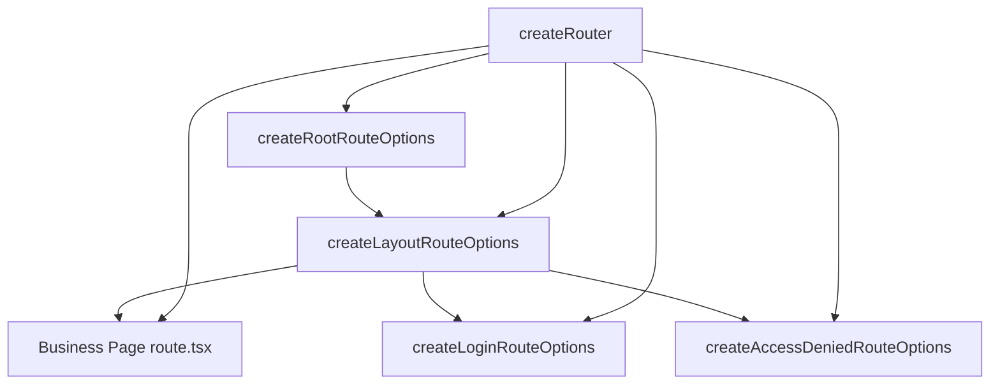

# Routing & Layout

VEF routing is built on top of `@tanstack/react-router`, but the APIs used most often in application code come from `@vef-framework-react/starter`:

- `createRouter()`
- `createRootRouteOptions()`
- `createLayoutRouteOptions()`
- `createLoginRouteOptions()`
- `createAccessDeniedRouteOptions()`

These helpers standardize concerns that appear repeatedly in admin applications: page titles, login redirects, permission checks, menu wiring, and default error states. This guide covers how the pieces fit together and where layout components enter the picture. For the full option table of every helper, see [Bootstrap and Routing](../reference/starter/bootstrap-and-routing.md).

## Typical Route Structure



## What `createRouter()` Covers

```ts
import { createRouter } from "@vef-framework-react/starter";

import { routeTree } from "./router.gen";
import { routerContext } from "./context";

const router = createRouter({
  history: "browser",
  routeTree,
  context: routerContext
});
```

It already wires `hash` / `browser` history creation, global pending / error / not-found components, route transition progress handling, default error notifications, tab state synchronization, and automatic response to unauthenticated and access-denied events.

The framework expects `RouterContext` to include at least a `router` field. In most projects a placeholder object is defined first:

```ts
import type { RouterContext } from "@vef-framework-react/starter";

export const routerContext: RouterContext = {
  router: undefined!
};
```

## The Layout Route Is the Core of the Routing Layer

Authenticated admin pages usually sit under a single layout route built with `createLayoutRouteOptions()`. It handles:

1. authentication checks
2. user-info and menu loading
3. writing menu state and permission tokens into `useAppStore`
4. redirecting unauthorized paths to the access-denied route

```tsx
import type { UserInfo } from "@vef-framework-react/starter";

import { createFileRoute } from "@tanstack/react-router";
import { createLayoutRouteOptions, INDEX_ROUTE_ID } from "@vef-framework-react/starter";

import { apiClient } from "../../api";
import { getUserInfo, logout } from "../../apis/auth";

function fetchUserInfo(): Promise<UserInfo> {
  return apiClient.fetchQuery({
    queryKey: [getUserInfo.key, { appId: "admin" }],
    queryFn: getUserInfo
  });
}

export const Route = createFileRoute(INDEX_ROUTE_ID)(
  createLayoutRouteOptions({
    title: "Admin System",
    onLogout: () => apiClient.executeMutation({ mutationFn: logout }),
    fetchUserInfo
  })
);
```

The root route (`createRootRouteOptions()`), login route (`createLoginRouteOptions()`), and access-denied route (`createAccessDeniedRouteOptions()`) follow the same shape — wrap a `createFileRoute()` call with the matching options helper. See [Bootstrap and Routing](../reference/starter/bootstrap-and-routing.md) for every option each helper accepts, and [Authentication](./authentication.md) for how login wiring specifically fits in.

## Layout Mental Model

Routing decides which page renders; layout components decide how it is framed. VEF splits that into two layers:

- **Application-level layout** — the `Layout` / `BaseLayout` shell internal to `@vef-framework-react/starter` (not exported): menu, user section, tabs, and the content area. It is not written from scratch — `createLayoutRouteOptions()` assembles it from the props passed to it (`title`, `onLogout`, and the other layout options; see [Application Shell](../reference/starter/application-shell.md)).
- **Page-level containers** — `Page` / `FlexCard` (from `@vef-framework-react/components`). These live inside the shell and frame a single page's content.

### `Page`

For pages that are not CRUD pages and do not require highly custom layout behavior, `Page` is usually the first container to use:

```tsx
import { Page } from "@vef-framework-react/components";

<Page title="System Monitor">
  Page content
</Page>
```

It supports a `title`, header/footer slots, left and right side panels, and page-level margin control. `CrudPage` (see [CRUD Pages](./crud.md)) is also built on `Page`, which is one of the reasons CRUD pages and regular business pages feel visually consistent.

### `FlexCard`

`FlexCard` is useful when a page needs a more flexible card-style container, especially for split layouts such as list + detail or tree + form.

## Recommended Usage

- Keep the root route focused on document titles and top-level shell concerns.
- Let the layout route own authentication, menus, permissions, and user loading.
- Keep page routes focused on page behavior; use `Page` for regular business pages and `FlexCard` for split panels and tree-table layouts.
- Prefer the framework event chain for unauthenticated and access-denied redirects instead of scattering manual `navigate()` calls across pages.
