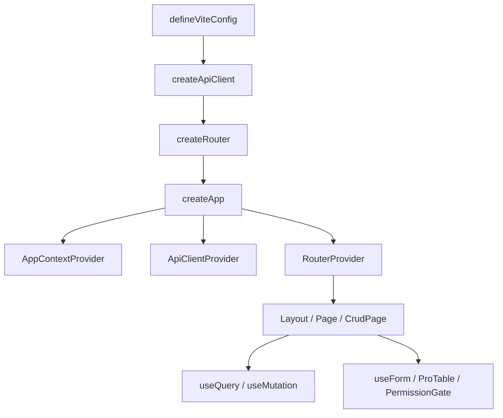

# VEF Framework React

VEF Framework React is a React solution for internal platforms, admin systems, and other enterprise-facing applications. It is not only a component library or a scaffold. Instead, it brings application bootstrap, routing, API integration, permissions, CRUD pages, forms, state management, visual schema editors, and UI building blocks under one consistent API surface.

This documentation focuses on one thing: **how to build applications with the framework's exported APIs**.  
The repository also includes a sample application, `playground`, which can be used as a reference for application structure and page composition.

## Why VEF

Most admin-style frontends re-solve the same handful of problems on every project: wiring up auth and token refresh, building a search-table-form CRUD page, showing permission-aware UI, and keeping forms consistent. VEF standardizes those problems behind exported APIs (`CrudPage`, `createCrudKit`, `useForm`, `ApiClient`, `PermissionGate`, and so on) instead of leaving every project to reinvent them.

VEF also works best when application code is organized around **page scenarios** rather than around large shared buckets such as `components`, `hooks`, or `services`. Page-local queries, forms, and table columns stay close to the page; only genuinely cross-page code gets promoted to a shared location. [Project Structure](./getting-started/project-structure.md) and [Project Conventions](./advanced/project-conventions.md) describe this in detail.

## The Package Map

VEF ships 9 packages under the `@vef-framework-react/*` scope. Six form the application runtime and UI; three are visual, schema-driven editors that can be embedded into a host application.

| Package | When You Reach for It | Common Exports |
| --- | --- | --- |
| `@vef-framework-react/starter` | Application bootstrap, routing, login pages, and layouts | `createApp`, `createRouter`, `createApiClient`, `createRootRouteOptions`, `createLayoutRouteOptions` |
| `@vef-framework-react/components` | Page UI, page containers, CRUD pages, forms, tables, notifications, icons, and charts | `Button`, `Page`, `CrudPage`, `createCrudKit`, `ProTable`, `Table`, `FormModal`, `FormDrawer`, `useForm`, `PermissionGate`, `Chart` |
| `@vef-framework-react/core` | Requests, query, stores, atoms, permission checks, and SSE | `ApiClient`, `useQuery`, `useMutation`, `createStore`, `createComponentStore`, `atom` |
| `@vef-framework-react/hooks` | Page-level helper hooks | `useDictionaryQuery`, `useHasMutating`, `useAuthorizedItems`, `useDebouncedValue` |
| `@vef-framework-react/shared` | Common types, validation, formatting, tree utilities, and event emitters | `z`, `EventEmitter`, `formatDate`, `flattenTree`, `withPinyin` |
| `@vef-framework-react/dev` | Vite, ESLint, Stylelint, and Commitlint configuration | `defineViteConfig`, `defineEslintConfig`, `defineStylelintConfig`, `defineCommitlintConfig` |
| `@vef-framework-react/form-editor` | Visual, schema-driven form designer for forms with hundreds of fields | `FormEditor`, `FormRenderer`, `FormEditorProvider` |
| `@vef-framework-react/approval-flow-editor` | Visual approval flow designer built on `@xyflow/react` + elkjs auto-layout | `ApprovalFlowEditor`, `toFlowDefinition`, `fromFlowDefinition` |
| `@vef-framework-react/approval-form-bridge` | Projects a form-editor schema into the backend approval form contract | `projectFormSchema`, `createApprovalRegistries`, `validateApprovalSchema` |

The three editor packages are independent of each other — a host application can embed `form-editor` alone, `approval-flow-editor` alone, or both together with `approval-form-bridge` acting as the projection layer between them.

## How These Docs Are Organized

The sidebar has 6 sections:

1. **Getting Started** — a linear tutorial. Install the framework, run a minimal app, then build a real CRUD page.
2. **Guides** — task-oriented "how do I do X" narratives (routing, data fetching, forms, tables, CRUD, state, auth, permissions, dictionaries, theming, error handling, hooks), ordered from foundational to advanced.
3. **Components** — an organized reference of every exported component, with prop tables and examples. Browse it as needed; it is not meant to be read start to finish.
4. **Visual Editors** — the form-editor, approval-flow-editor, and approval-form-bridge packages: what they are, how to embed them in a host app, and their schema/type reference.
5. **API Reference** — dry, per-package export signatures. Come here once you already know what you're looking for.
6. **Advanced** — extension points, performance habits, testing suggestions, and project governance conventions, for once the basics feel comfortable.

Guides own the narrative and the "why." Components own prop tables. API Reference owns exact signatures. If the same concept shows up in more than one of these, that is a bug — the guide should link to the component or reference page instead of repeating it.

## Reading Path

For a first-time reader, this order builds understanding incrementally:

1. **Getting Started**, in order:
   1. [Installation](./getting-started/installation.md)
   2. [Quick Start](./getting-started/quick-start.md)
   3. [Your First CRUD Page](./getting-started/first-crud-page.md)
   4. [Configuration](./getting-started/configuration.md)
   5. [Project Structure](./getting-started/project-structure.md)
2. **Guides**, in order — each one leans on the concepts before it:
   1. [Routing & Layout](./guide/routing.md)
   2. [Data Fetching](./guide/data-fetching.md)
   3. [Forms](./guide/forms.md)
   4. [Tables](./guide/tables.md)
   5. [CRUD Pages](./guide/crud.md)
   6. [State Management](./guide/state-management.md)
   7. [Authentication](./guide/authentication.md)
   8. [Permissions](./guide/permissions.md)
   9. [Data Dictionaries](./guide/data-dictionaries.md)
   10. [Theming](./guide/theming.md)
   11. [Error Handling](./guide/error-handling.md)
   12. [Hooks](./guide/hooks.md)
3. **Components** — from here on, treat the docs as a reference rather than a sequence. Open the [component catalog](./components/overview.md) whenever a page needs a specific building block.
4. **Visual Editors** — read the [overview](./editors/overview.md) only if the application embeds the form designer or the approval flow designer.
5. **API Reference** — start from the [package map](./reference/overview.md) whenever exact export signatures are needed.
6. **Advanced** — [project conventions](./advanced/project-conventions.md), [custom form components](./advanced/custom-form-components.md), [performance](./advanced/performance.md), and [testing](./advanced/testing.md) once the day-to-day workflow is familiar.

## Typical Application Composition

In most projects, the application flow looks like this:

1. Use `@vef-framework-react/dev` to establish the build and linting baseline.
2. Use `@vef-framework-react/starter` to assemble the application entry, router, and layouts.
3. Use `@vef-framework-react/core` to define request functions, state containers, and query logic.
4. Use `@vef-framework-react/components` and `@vef-framework-react/hooks` to build pages.
5. Use `@vef-framework-react/shared` for validation, formatting, and data transformation.
6. Optionally embed `form-editor` and/or `approval-flow-editor` (bridged by `approval-form-bridge`) for schema-driven design surfaces inside the application.

## Sample Application Reference Points

The sample application (`playground`) includes representative examples for:

- `src/main.ts` — the `createApp().render()` entry point
- `src/api/index.ts` — standard `createApiClient()` configuration
- `src/pages/__root.ts` — root route setup with `createRootRouteOptions()`
- `src/pages/_layout/route.tsx` — layout and guard setup with `createLayoutRouteOptions()`
- `src/pages/_layout/auth/user/route.tsx` — a typical `CrudPage` implementation
- `src/pages/_layout/auth/user/components/form.tsx` — a typical `useFormContext()` + `AppField` form
- `src/pages/_layout/sys/form-editor/route.tsx` — host integration for the form editor
- `src/pages/_layout/sys/approval-flow-editor/route.tsx` — host integration for the approval flow editor
- `src/pages/_layout/sys/flow-designer-wizard/` — `approval-form-bridge` projecting a form-editor schema into an approval flow

## Documentation Notes

- Example code is based on the current public API surface and follows the same structural patterns used in the sample application.
- Unless otherwise noted, examples only use publicly exported framework APIs.
- The documentation focuses on how APIs are combined in application code, rather than on internal implementation details.
