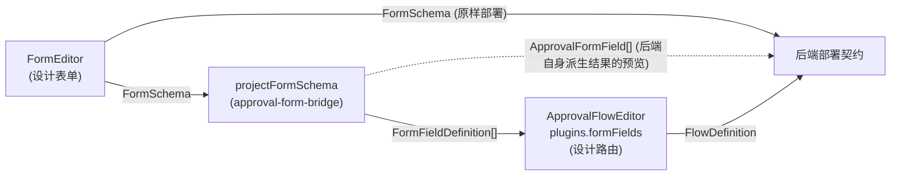

# 可视化编辑器

VEF 提供三个相互独立的包，用于以可视化方式设计表单和审批流程，而不必手写 schema JSON:

| 包 | 是什么 | 输入 | 输出 |
| --- | --- | --- | --- |
| [`@vef-framework-react/form-editor`](./form-editor/overview.md) | 一个可视化表单设计器（`FormEditor`），加上一个运行时渲染器（`FormRenderer`） | — | `FormSchema` |
| [`@vef-framework-react/approval-form-bridge`](./approval-form-bridge.md) | 一个纯函数投影库——没有编辑器 UI | `FormSchema` | `FormFieldDefinition[]`（流程编辑器的字段清单）+ `ApprovalFormField[]`（后端扁平字段列表的设计器侧预览）+ 保存关卡 issue |
| [`@vef-framework-react/approval-flow-editor`](./approval-flow-editor/overview.md) | 一个可视化审批路由设计器（`ApprovalFlowEditor`） | `FormFieldDefinition[]`（通过 `plugins.formFields`） | `FlowDefinition` |

## 三者的关系

一个审批流程分成两个独立设计、再拼合起来的部分: **收集哪些数据**（表单）与 **谁按什么顺序、在什么条件下审批**（流程）。`approval-form-bridge` 是两者之间的接缝——它自身不渲染任何内容，只负责把一种 schema 形态投影为另一种。

1. **`form-editor`** 设计提交者要填写的表单——字段、布局，以及各设备下的展现方式——将其表示为一个 `FormSchema`。自 v2.10.0 起，这份完整 schema 本身就是部署载荷: 后端原样接收它，并在服务端自行派生出扁平字段列表。
2. **`approval-form-bridge`** 的 `projectFormSchema` 对该 schema 只遍历一次，并从这同一次遍历中同时产出两样东西，因此二者永远不会互相矛盾: 为流程编辑器整形好的 `FormFieldDefinition[]` 字段清单，以及扁平的 `ApprovalFormField[]`——对 Go 后端部署时将派生出什么的设计器侧精确预览，用于提前发现契约适配问题。`validateApprovalSchema` 把 form-editor 的结构校验与投影结果的契约适配校验合并成一个统一的保存关卡。
3. **`approval-flow-editor`** 设计路由图——start / approval / handle / condition / cc / end 节点——将其表示为一个 `FlowDefinition`。它通过 `plugins.formFields` 读取被投影出来的 `FormFieldDefinition[]`，用于驱动其条件编辑器和字段权限表，并在校验时用同一份字段清单对节点配置做交叉检查。

每个包都可以独立使用: `approval-flow-editor` 只需要一个 `FormFieldDefinition[]` 数组（手写的，或以任何其他方式获取的都行），并不特别依赖这个桥接包；`form-editor` 完全不依赖任何审批相关的包。只有当宿主要构建端到端的审批流设计器时，三者才会组合成一条流水线——就像 `@vef-framework-react/approval-flow-editor` 自己的 playground 向导演示那样。

若想要这套组合的"开箱即用"版本，[审批引擎](../engines/approval/overview.md)相关页面（`@vef-framework-react/approval`，v2.12.0）把这三个包全部内嵌在引擎的持久化链路之后——其流程设计器向导负责把这些编辑器串接起来，并从 `approval-flow-editor` 重导出选择器契约类型（`EditorPlugins`、`PickerProps`、`PrincipalKind`）。

## 从哪里开始

- 设计提交者要填写的内容 → [表单编辑器](./form-editor/overview.md)
- 把设计好的表单桥接到审批后端的契约 → [审批表单桥接](./approval-form-bridge.md)
- 设计由谁按什么顺序审批 → [审批流编辑器](./approval-flow-editor/overview.md)
