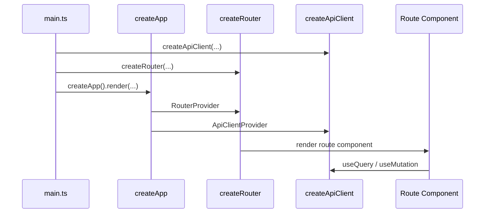

# 快速开始

本页将带你完成一个最小但真实可用的 VEF 应用骨架。读完之后，你应该能更容易识别出应用的主流程:

1. 应用入口是如何编写的
2. `apiClient` 是如何创建的
3. `router` 是如何创建的
4. 页面是如何访问框架能力的

## 最小可运行流程



## 第一步: 配置 Vite

```ts title="vite.config.ts"
import { defineViteConfig } from "@vef-framework-react/dev";

export default defineViteConfig({
  react: {
    useCompiler: true
  }
});
```

## 第二步: 创建 API 客户端

`starter` 导出的 `createApiClient()` 已经接好了 token 存储、未认证处理、拒绝访问处理和全局消息反馈。  
在大多数应用中，只需要补充 HTTP 相关的配置。

```ts title="src/api/index.ts"
import { createApiClient } from "@vef-framework-react/starter";

export const apiClient = createApiClient({
  http: {
    // Injected from VEF_APP_API_BASE_URL by the dev plugin (see Configuration)
    baseUrl: __VEF_APP_CONFIG__.VEF_APP_API_BASE_URL,
    okCode: 0,
    tokenExpiredCode: 1002,
    timeout: 30_000,
    async refreshToken(tokens) {
      // JWT-mode backends return a refresh token; since v2.10.0 the field is
      // optional, so guard it before the exchange.
      if (!tokens.refreshToken) {
        throw new Error("No refresh token");
      }

      const response = await fetch("/api/auth/refresh", {
        method: "POST",
        headers: { "Content-Type": "application/json" },
        body: JSON.stringify({ refreshToken: tokens.refreshToken })
      });

      return await response.json();
    }
  },
  query: {
    staleTime: 60_000,
    gcTime: 10 * 60_000
  }
});
```

`AuthTokens.refreshToken` 是可选的：签发有状态不透明令牌（opaque token）会话的后端（由服务端滑动续期）不会返回刷新令牌——面对这类后端，直接省略 `refreshToken` 回调即可，过期的会话会径直进入未认证流程。

## 第三步: 定义请求函数

VEF 应用通常通过 `apiClient.createQueryFn()` 和 `apiClient.createMutationFn()` 暴露领域 API。

```ts title="src/apis/auth.ts"
import type { AuthTokens } from "@vef-framework-react/core";
import type { LoginParams, UserInfo } from "@vef-framework-react/starter";

import { apiClient } from "../api";

export const login = apiClient.createMutationFn(
  "login",
  http => async (params: LoginParams) => {
    const result = await http.post<AuthTokens>("/api/login", {
      data: params
    });

    return {
      message: result.message,
      tokens: result.data
    };
  }
);

export const logout = apiClient.createMutationFn(
  "logout",
  http => () => http.post("/api/logout")
);

export const getUserInfo = apiClient.createQueryFn(
  "get_user_info",
  http => async () => {
    const result = await http.get<UserInfo>("/api/user/info");
    return result.data;
  }
);
```

## 第四步: 创建根路由和布局路由

```ts title="src/pages/__root.ts"
import type { RouterContext } from "@vef-framework-react/starter";

import { createRootRouteWithContext } from "@tanstack/react-router";
import { createRootRouteOptions } from "@vef-framework-react/starter";

export const Route = createRootRouteWithContext<RouterContext>()(
  createRootRouteOptions({
    appTitle: "VEF Demo"
  })
);
```

```tsx title="src/pages/_layout/route.tsx"
import type { UserInfo } from "@vef-framework-react/starter";

import { createFileRoute } from "@tanstack/react-router";
import { createLayoutRouteOptions, INDEX_ROUTE_ID } from "@vef-framework-react/starter";

import { apiClient } from "../api";
import { getUserInfo, logout } from "../apis/auth";

async function handleLogout(): Promise<void> {
  await apiClient.executeMutation({
    mutationFn: logout
  });
}

function fetchUserInfo(): Promise<UserInfo> {
  return apiClient.fetchQuery({
    queryKey: [getUserInfo.key, { appId: "admin" }],
    queryFn: getUserInfo
  });
}

export const Route = createFileRoute(INDEX_ROUTE_ID)(
  createLayoutRouteOptions({
    title: "VEF Demo",
    onLogout: handleLogout,
    fetchUserInfo
  })
);
```

## 第五步: 创建登录路由和拒绝访问路由

```ts title="src/pages/_common/login.ts"
import { createFileRoute } from "@tanstack/react-router";
import { createLoginRouteOptions, LOGIN_ROUTE_ID } from "@vef-framework-react/starter";

import { apiClient } from "../api";
import { login } from "../apis/auth";

export const Route = createFileRoute(LOGIN_ROUTE_ID)(
  createLoginRouteOptions({
    onLogin: params => apiClient.executeMutation({ mutationFn: login, params })
  })
);
```

```ts title="src/pages/_common/access-denied.ts"
import { createFileRoute } from "@tanstack/react-router";
import { ACCESS_DENIED_ROUTE_ID, createAccessDeniedRouteOptions } from "@vef-framework-react/starter";

export const Route = createFileRoute(ACCESS_DENIED_ROUTE_ID)(
  createAccessDeniedRouteOptions()
);
```

## 第六步: 创建路由器

```ts title="src/router/context.ts"
import type { RouterContext } from "@vef-framework-react/starter";

export const routerContext: RouterContext = {
  router: undefined!
};
```

```ts title="src/router/index.ts"
import { createRouter } from "@vef-framework-react/starter";

import { routeTree } from "./router.gen";
import { routerContext } from "./context";

const router = createRouter({
  history: "browser",
  routeTree,
  context: routerContext
});

export default router;
```

`src/router/router.gen.ts` 是 `defineViteConfig` 启用的路由插件生成的路由树。开发服务器运行期间它会被自动创建并保持更新——切勿手工编辑。

## 第七步: 渲染应用

```ts title="src/main.ts"
import { createApp } from "@vef-framework-react/starter";

import { apiClient } from "./api";
import router from "./router";

createApp().render({
  apiClient,
  router,
  appContext: {
    hasPermission(token) {
      return token.startsWith("demo:");
    },
    codeSetQueryFn: undefined,
    fileBaseUrl: "/files"
  },
  appVersionNotification: {
    enabled: import.meta.env.PROD,
    checkInterval: 10 * 60
  }
});
```

`codeSetQueryFn` 是宿主提供的码集查询函数（以 `"sys.user.gender"` 这类字符串键名索引的选项列表）；在后端提供该接口之前，先保持 `undefined` 即可——参见[码集](../guide/code-sets.md)。

## 第八步: 添加一个真实页面

先定义一个 dashboard API 查询:

```ts title="src/apis/dashboard.ts"
import { apiClient } from "../api";

export const getDashboard = apiClient.createQueryFn(
  "get_dashboard",
  http => async () => {
    const result = await http.get<{ message: string }>("/api/dashboard");
    return result.data;
  }
);
```

然后把它接入一个路由:

```tsx title="src/pages/_layout/index/route.tsx"
import { createFileRoute } from "@tanstack/react-router";
import { Button, Card, Page, Text, Title } from "@vef-framework-react/components";
import { useQuery } from "@vef-framework-react/core";

import { getDashboard } from "../../../apis/dashboard";

export const Route = createFileRoute("/_layout/")({
  component: RouteComponent
});

function RouteComponent() {
  const dashboard = useQuery({
    queryKey: [getDashboard.key],
    queryFn: getDashboard
  });

  return (
    <Page margin>
      <Title level={3}>Home</Title>
      <Card>
        <Text>{dashboard.data?.message ?? "Welcome to VEF"}</Text>
        <Button type="primary">Start Building</Button>
      </Card>
    </Page>
  );
}
```

## 后续阅读

上面的骨架渲染了一个页面，但还没有和真实的列表、表单或表格打交道。接下来可以阅读:

1. [你的第一个 CRUD 页面](./first-crud-page.md) —— 把这个骨架变成一个可用的列表+表单页面
2. [工程配置](./configuration.md)
3. [项目结构](./project-structure.md)
4. [路由与布局](../guide/routing.md)
5. [数据请求](../guide/data-fetching.md)
