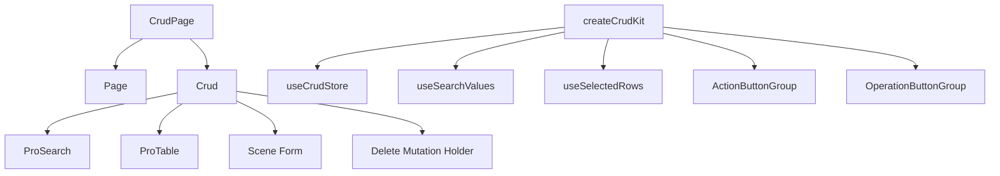

# CRUD 页面

`@vef-framework-react/components` 中生产力最高的部分之一，是 `CrudPage` 与 `createCrudKit()` 的组合。它的目标不只是减少表格样板代码，而是把搜索、列表加载、表单场景、删除流程、批量操作以及页面局部状态统一标准化。本篇聚焦于这些部分为什么是这样设计的；完整的属性参考见 [Crud 与 CrudPage](../components/crud.md)。

## 一个 CRUD 页面由哪些部分组成



## 最小 `CrudPage` 示例

```tsx
<CrudPage
  rowSelection
  basicSearch={<BasicSearch />}
  columnSettings={{ storageKey: "page.auth.user" }}
  deleteManyMutationFn={deleteUsers}
  deleteMutationFn={deleteUser}
  queryFn={findUserPage}
  renderForm={scene => <Form scene={scene} />}
  rowKey="id"
  tableColumns={tableColumns}
  formMutationFns={{
    create: createUser,
    update: updateUser
  }}
  sceneDefaultFormValues={{
    create: { isActive: true, isLocked: false }
  }}
/>
```

## `CrudPage` 最适合什么场景

当一个页面同时具备列表查询、搜索区域、新建或编辑表单、单条删除以及批量操作时，`CrudPage` 通常是不错的选择。如果页面只是一张只读表格，单独使用 `ProTable` 往往就够了——见 [表格](./tables.md)。

## 为什么 `renderForm(scene)` 很重要

CRUD 表单很少只有一种形态。新建流程和编辑流程通常存在一些细微但重要的差异：

- 密码在新建时必填，在编辑时可选
- 部分默认值只在新建时生效
- 某些字段在编辑时被禁用

这就是为什么表单要按场景渲染，而不是做成一个固定不变的静态表单：

```tsx
renderForm={scene => <Form scene={scene} />}
```

## 为什么 `createCrudKit()` 很重要

`createCrudKit()` 把一个页面自身的泛型类型固定进一个可复用的局部工具集：

```ts
import { createCrudKit } from "@vef-framework-react/components";

export const {
  useCrudStore,
  useSearchValues,
  useSelectedRows,
  OperationButtonGroup,
  ActionButtonGroup
} = createCrudKit<User, UserSearch, UserFormSceneValues>();
```

有了它之后，搜索组件可以读取到强类型的搜索值，工具栏按钮可以直接访问选中行，行操作列也可以直接访问 `openForm`、`delete` 和 `refetchQuery`，而不需要在每个涉及该页面的组件中重复传递泛型参数。

## 行为说明

`delete`/`deleteMany` 成功后的选中状态清空行为，以及各场景 `formActionsRenderers` 的签名，完整说明见 [Crud 与 CrudPage](../components/crud.md)。

## 复用策略

最值得复用的部分通常是页面的查询函数、页面局部的 `createCrudKit()` 结果、搜索组件和表单组件。这样既能保持页面的一致性，又不会让它们过于僵化。
