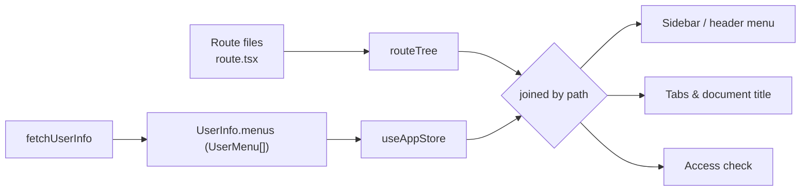

# 菜单与导航

[你的第一个 CRUD 页面](../getting-started/first-crud-page.md) 的终点是一个可用的 `/products` 路由——但只创建路由文件并不会让它出现在侧边栏里。本篇解释菜单究竟从哪里来、它如何与路由树关联，以及要让新页面显示出来（或刻意不显示）需要改什么。

## 路由是代码，菜单是数据

VEF 维护着两棵彼此独立的树：

- **路由是代码。** 每个页面都是一个 `route.tsx` 文件，编译进 TanStack Router 的路由树。URL 上渲染什么完全由路由器决定。见 [路由与布局](./routing.md)。
- **菜单是数据。** 侧边栏根据 `UserInfo.menus` 渲染——即传给 `createLayoutRouteOptions()` 的 `fetchUserInfo` 函数返回的 `UserMenu[]`。框架从不会根据路由文件推导菜单。

布局层通过**路径**把两棵树关联起来：某个菜单项的 `path` 等于某条路由的模板（`/products`，参数化路由则是 `/report/$key`）时，点击它就会导航到该路由、该路由激活时它会高亮，并且——很重要——*它授予了对该路由的访问权*。在布局路由之下，任何未被菜单覆盖的路径都会被重定向到无权限页面，因此菜单树同时充当了页面级的授权清单。



正是这种分离让后端可以给不同用户下发不同的侧边栏，而无需发布不同的前端——也是为什么"我创建了页面但菜单里没有它"是数据问题，而不是代码问题。

## `UserMenu` 契约

`fetchUserInfo` 必须解析为一个 `UserInfo`，其 `menus` 字段承载整棵菜单树：

```ts
import type { UserInfo, UserMenu, UserMenuMeta } from "@vef-framework-react/starter";

interface UserMenu {
  type: UserMenuType;   // "directory" | "menu" | "view" | "report" | custom strings
  path: string;         // route template this entry points at
  name: string;         // label in the sidebar, tabs, and document title
  icon?: string;        // lucide icon name, e.g. "shield" or "book-open"
  meta?: UserMenuMeta;  // params / search the entry binds, plus app-specific keys
  children?: UserMenu[];
}
```

| 字段 | 必填 | 含义 |
| --- | --- | --- |
| `type` | 是 | 布局如何对待该项——见下表。这是一个开放联合类型（`LiteralUnion`），允许项目自定义取值；自定义值的行为与 `"menu"` 相同。 |
| `path` | 是 | 路由**模板**而非实例化后的 URL：写 `/report/$key`，绝不要写 `/report/sales`。它必须与某条路由的完整路径匹配，导航和访问校验才能生效。 |
| `name` | 是 | 显示名称。除非路由在 context 里设置了 `routeTitle`，它也用作标签页名称和文档标题（`${appTitle} \| ${name}`）。 |
| `icon` | 否 | [lucide](https://lucide.dev/icons) 图标名（kebab-case），通过 `DynamicIcon` 渲染。无法识别的名字会渲染成"未知"占位图标，而不会崩溃。 |
| `meta` | 否 | 该项绑定的 `params` / `search`（见下文），以及项目通过 `Register['menuMeta']` 声明的任意扩展键（见 [Store 与类型](../reference/starter/stores-and-types.md)）。 |
| `children` | 否 | 嵌套子项；可递归嵌套，没有固定深度限制。 |

框架赋予了语义的 `type` 取值：

| `type` | 侧边栏 | 可导航 | 典型用途 |
| --- | --- | --- | --- |
| `"directory"` | 渲染为子菜单 | 否——点击展开它（混合布局下，选中顶层分区会跳到其第一个非 `view` 叶子） | 分组节点 |
| `"menu"` | 渲染为菜单项 | 是 | 普通页面 |
| `"view"` | **隐藏** | 是（通过 URL / 编程式导航） | 需要访问权和标签页、但不在侧边栏出现的详情页或向导页 |
| `"report"` | 渲染为菜单项 | 是 | 参数化的报表入口；渲染上与 `"menu"` 完全一致 |

只有 `"directory"` 和 `"view"` 会改变行为。其他任何值——包括 `"report"` 和自定义字符串——都渲染为可点击的菜单项。

### `UserMenuMeta`：绑定 `params` 与 `search`

`meta.params` 和 `meta.search` 是扁平的字符串映射，点击时会被钉到菜单指向的路由上：

```ts
const reportMenus: UserMenu[] = [
  {
    type: "report",
    path: "/report/$key",
    name: "Sales Report",
    meta: { params: { key: "sales" } }
  },
  {
    type: "report",
    path: "/report/$key",
    name: "Inventory Report",
    meta: { params: { key: "inventory" }, search: { range: "month" } }
  }
];
```

两个菜单项共享同一个路由文件（`/report/$key`），却是两个各自独立的菜单：菜单的身份是它的路径**加上**它绑定的 params 和 search。点击时会带着这些值精确导航，高亮解析也遵循同样的规则——候选项必须与当前路由共享模板、精确绑定其 params，且只钉住 URL 上确实存在的 search 键（不钉任何 search 的菜单可以匹配 `?page=2` 之类的运行时查询）。多个候选同时满足时，search 最具体的那个胜出，因此一个裸列表入口和一个预筛选变体可以正确共存。

## 菜单数据从哪里来

整条链路由 `createLayoutRouteOptions()` 负责。它的 loader 调用你的 `fetchUserInfo`，然后派生出若干冻结的结构写入 `useAppStore`：

| Store 字段 | 内容 |
| --- | --- |
| `userInfo` | `UserInfo` 中除 `permissionTokens` 外的全部内容 |
| `userMenuMap` | 每一个菜单项（含 `"view"`），以路径 + 绑定的 params/search 为键 |
| `menuPathMap` | 菜单键 → 其祖先链，用于展开当前激活的分区 |
| `menuPathSet` | 菜单覆盖的全部去重路由模板——即访问清单 |
| `menuItems` | 实际渲染的侧边栏菜单项（`type: "view"` 的项已被过滤掉） |
| `permissionTokens` | `UserInfo.permissionTokens` 转成的 `Set` |

布局路由的两个配置后果值得记住：

- **每个应用会话只拉取一次。** 布局路由使用 `staleTime: Infinity` 和 `shouldReload: false`，所以 `fetchUserInfo` 在首次认证导航时执行，路由切换不会重新执行。后端改动的菜单要等下一次整页刷新（或退出后重新登录——登出会清空菜单状态）才会出现，而不是下一次点击。
- **不做持久化。** `useAppStore` 只把 `isAuthenticated`、`authTokens` 和 `custom` 持久化到 local storage。菜单和权限令牌在每次硬刷新时重新拉取，过期的菜单数据不会跨会话残留。

同一个 loader 还负责访问校验：（重新）构建 `menuPathSet` 后，它把当前位置解析成路由模板，若没有任何菜单覆盖它就重定向到 `/access-denied`。此后每次导航时 `beforeLoad` 都会重复这项检查。守卫的完整顺序见 [权限](./permissions.md)。

## 演练：让 `/products` 出现在侧边栏

假设你刚完成 [你的第一个 CRUD 页面](../getting-started/first-crud-page.md)：`src/pages/_layout/products/route.tsx` 已经存在，路由树也认识 `/_layout/products`。但侧边栏里什么都没有——直接输入 URL 访问 `/products` 还会被重定向到无权限页面，因为没有任何菜单覆盖它。

### 开发阶段：静态菜单

在后端接口还不存在时，直接在 `fetchUserInfo` 里返回菜单（或放进你的 dev mock——playground 应用在它的 mock 层里正是这么做的）：

```ts
import type { UserInfo, UserMenu } from "@vef-framework-react/starter";

const menus: UserMenu[] = [
  { type: "menu", path: "/", name: "Home", icon: "home" },
  { type: "menu", path: "/products", name: "Products", icon: "package" }
];

function fetchUserInfo(): Promise<UserInfo> {
  return Promise.resolve({
    id: "dev",
    name: "Developer",
    gender: "unknown",
    permissionTokens: ["*"],
    menus,
    details: {}
  });
}
```

刷新应用：侧边栏出现带 package 图标的 **Products**，点击导航到 `/products`，同时打开一个标签页，文档标题变为 `<appTitle> | Products`。

### 生产环境：后端驱动的菜单

在已部署的应用中，`fetchUserInfo` 调用后端（接线方式见 [路由与布局](./routing.md)），由后端按用户组装 `menus`——通常来自一张通过菜单管理页维护的菜单表，并按用户角色过滤。让新页面出现于是变成一次数据操作：插入一条 `path` 为 `/products` 的菜单记录，分配给相应角色，然后刷新。除了发布路由本身，前端不需要任何额外部署。

无论哪种方式，规则都一样：**当某个菜单项的 `path` 与页面的路由模板匹配时，页面才变得可达。** 如果页面应当可达但*不*应被列出——比如 `/products/$id` 这样的详情页——请给它一条 `type: "view"` 的菜单项，而不是干脆不写，否则访问校验会拦住它。

## 嵌套、图标，以及菜单做不到的事

分组就是纯数据——一条带 `children` 的 `"directory"` 项：

```ts
const menus: UserMenu[] = [
  {
    type: "directory",
    path: "/catalog",
    name: "Catalog",
    icon: "boxes",
    children: [
      { type: "menu", path: "/catalog/products", name: "Products", icon: "package" },
      { type: "menu", path: "/catalog/categories", name: "Categories", icon: "tags" },
      { type: "view", path: "/catalog/products/$id", name: "Product Detail" }
    ]
  }
];
```

目录在垂直布局下渲染为子菜单；混合布局下它变成页头的顶层入口，其子项填充侧边栏，选中它会跳到第一个非 `view` 叶子。当前路由的祖先链会自动展开；主题设置开启手风琴模式时，展开一个分区会收起它的同级分区。

图标通过 `DynamicIcon` 按名称按需加载——惰性、带缓存、并发受限——所以再大的菜单树也不会把所有图标提前打进包里。lucide 图标库里的任何名字都可用，除此之外都不行。

`UserMenu` 刻意**不**支持两件事：

- **外部链接。** 点击菜单永远是对 `path` 做路由导航，不存在 `window.open` 分支。外部链接请放进 `headerActions` 或某个页面里。
- **客户端可见性规则。** `UserMenu` 上没有 `hidden` 或 `requiredPermissions` 字段；`fetchUserInfo` 返回什么侧边栏就渲染什么。过滤是数据生产方的职责（见下文）。

## 菜单与标签页

标签页跟踪接在 `createRouter()` 内部（见 [路由与布局](./routing.md)），并以菜单树为准：每次导航后，框架解析哪个菜单项拥有匹配到的路由——模板相同、绑定的 params 相同。若存在这样的菜单，就在 `useTabStore` 里新增（或重新激活）一个标签页，名称取路由 context 里的 `routeTitle`（若设置了），否则取菜单的 `name`。若**没有**任何菜单拥有该路由，则不会出现标签页——这是详情页需要 `"view"` 菜单项的又一个原因。

标签页的身份是完整路径加上实际的 params 和 search，所以 `/report/sales` 和 `/report/inventory` 虽共享一个路由文件，却各占一个标签页。`useTabStore` 是公开 API：它暴露 `tabs` 和 `activeTabId` 状态，以及 `setActiveTabId`、`setTabs`、`addTab`、`removeTab`、`removeAllTabs`、`removeAllTabsExcept`、`removeLeftTabs`、`removeRightTabs` 这些操作——与标签栏右键菜单使用的是同一套。打开的标签页持久化在 local storage 里，刷新后依然保留。

## 菜单与权限

框架不在客户端过滤菜单树。它实际做的是：

- **页面级访问就是菜单树本身。** `menuPathSet`——由 `fetchUserInfo` 的返回值构建——是用户在布局之下可以访问的路由模板白名单。后端对某个用户省略一条菜单，就等于同时收回了那个页面。
- **令牌校验是另一条独立的轴。** 同一份 `UserInfo` 里的 `permissionTokens` 落进 `useAppStore`，驱动按钮级和元素级的检查（`PermissionGate`、`useHasPermissions`、`useAuthorizedItems`）——见 [权限](./permissions.md)。

所以在 VEF 里，"按权限过滤的菜单"的含义是：后端在返回 `UserInfo` 之前按用户过滤好 `menus`，前端对渲染和路由都信任这个结果。如果你需要按令牌隐藏一份*本地静态*的条目列表——比如设置页的分区列表——那是 `useAuthorizedItems()` 的用武之地，而不是侧边栏。

## 疑难排查

| 症状 | 原因 | 处理 |
| --- | --- | --- |
| 页面路由存在，但访问它被重定向到无权限页面 | 没有菜单项覆盖它的路由模板 | 添加一条 `path` 等于该路由完整路径的菜单——不想在侧边栏列出就用 `type: "view"` |
| 菜单项渲染出来了，但点击后显示 not-found 页面 | `path` 不匹配任何路由——拼写错误、缺少 `route.tsx`，或生成的路由树未更新 | 修正路径，或创建路由并让路由树重新生成；菜单路径从不会被拿去和路由树校验 |
| 参数化路由激活时侧边栏不高亮 | 菜单项绑定的 `meta.params` 与 URL 携带的不一致，或路由有 params 而菜单没绑 | 在 `meta.params` 里精确绑定该路由的 params |
| 页面能加载但没有出现标签页 | 没有菜单项拥有该路由（模板 + params 匹配） | 为它添加一条 `"view"` 菜单项 |
| 后端改了菜单但前端没变化 | 用户信息每个应用会话只拉取一次（`staleTime: Infinity`） | 整页硬刷新 |
| 菜单图标渲染成"未知"占位符 | `icon` 不是合法的 lucide 动态图标名 | 使用 lucide 图标库中的 kebab-case 名称，如 `"book-open"` |
| 不该看到某菜单的用户却看到了它 | 是后端返回了它——客户端从不过滤菜单 | 在组装 `UserInfo` 时于服务端过滤 `menus` |

`createLayoutRouteOptions()` 的完整选项表见 [应用启动与路由](../reference/starter/bootstrap-and-routing.md)；store 与类型的完整清单见 [Store 与类型](../reference/starter/stores-and-types.md)。
