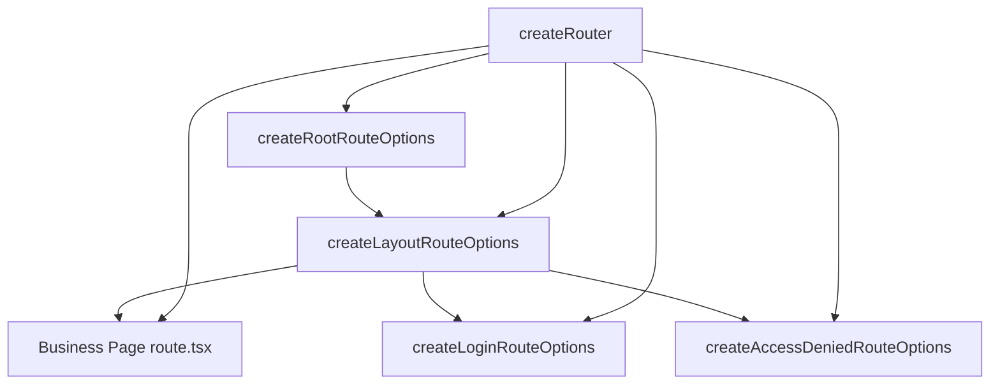

# 路由与布局

VEF 的路由建立在 `@tanstack/react-router` 之上，但业务代码中最常用到的 API 来自 `@vef-framework-react/starter`：

- `createRouter()`
- `createRootRouteOptions()`
- `createLayoutRouteOptions()`
- `createLoginRouteOptions()`
- `createAccessDeniedRouteOptions()`

这些辅助函数把后台应用里反复出现的问题标准化：页面标题、登录跳转、权限校验、菜单装配以及默认错误态。本篇指南介绍这些部分如何组合在一起，以及布局组件在其中扮演的角色。每个辅助函数的完整选项表见 [应用启动与路由](../reference/starter/bootstrap-and-routing.md)。

## 典型的路由结构



## `createRouter()` 涵盖了什么

```ts
import { createRouter } from "@vef-framework-react/starter";

import { routeTree } from "./router.gen";
import { routerContext } from "./context";

const router = createRouter({
  history: "browser",
  routeTree,
  context: routerContext
});
```

它已经接好了 `hash` / `browser` history 的创建、全局 pending / error / not-found 组件、路由切换进度处理、默认错误通知、标签页状态同步，以及对未认证和无权限事件的自动响应。

框架要求 `RouterContext` 至少包含一个 `router` 字段。多数项目会先定义一个占位对象：

```ts
import type { RouterContext } from "@vef-framework-react/starter";

export const routerContext: RouterContext = {
  router: undefined!
};
```

## 布局路由是路由层的核心

已认证的后台页面通常挂在由 `createLayoutRouteOptions()` 构建的单个布局路由之下。它负责处理：

1. 认证检查
2. 用户信息与菜单加载
3. 将菜单状态和权限令牌写入 `useAppStore`
4. 将无权限路径重定向到无权限页面

```tsx
import type { UserInfo } from "@vef-framework-react/starter";

import { createFileRoute } from "@tanstack/react-router";
import { createLayoutRouteOptions, INDEX_ROUTE_ID } from "@vef-framework-react/starter";

import { apiClient } from "../../api";
import { getUserInfo, logout } from "../../apis/auth";

function fetchUserInfo(): Promise<UserInfo> {
  return apiClient.fetchQuery({
    queryKey: [getUserInfo.key, { appId: "admin" }],
    queryFn: getUserInfo
  });
}

export const Route = createFileRoute(INDEX_ROUTE_ID)(
  createLayoutRouteOptions({
    title: "Admin System",
    onLogout: () => apiClient.executeMutation({ mutationFn: logout }),
    fetchUserInfo
  })
);
```

根路由（`createRootRouteOptions()`）、登录路由（`createLoginRouteOptions()`）和无权限路由（`createAccessDeniedRouteOptions()`）遵循同样的形态——用对应的选项辅助函数包裹一次 `createFileRoute()` 调用即可。每个辅助函数接受的完整选项见 [应用启动与路由](../reference/starter/bootstrap-and-routing.md)；登录逻辑具体如何接入见 [认证](./authentication.md)。

## 布局的心智模型

路由决定渲染哪个页面；布局组件决定页面如何被框住。VEF 把它拆成两层：

- **应用级布局** —— `Layout` / `BaseLayout`（来自 `@vef-framework-react/starter`）。这是持久化的外壳：菜单、用户区域、标签页和内容区。它通常不需要从零编写——`createLayoutRouteOptions()` 会根据传入的属性（`title`、`onLogout` 以及 `LayoutProps` 的其余部分）自动装配。
- **页面级容器** —— `Page` / `FlexCard`（来自 `@vef-framework-react/components`）。它们位于外壳内部，负责框住单个页面的内容。

### `Page`

对于非 CRUD 页面、也不需要高度自定义布局行为的页面，`Page` 通常是首选容器：

```tsx
import { Page } from "@vef-framework-react/components";

<Page title="System Monitor">
  Page content
</Page>
```

它支持 `title`、页头/页脚插槽、左右侧边栏，以及页面级的间距控制。`CrudPage`（见 [CRUD 页面](./crud.md)）同样构建在 `Page` 之上，这也是 CRUD 页面和普通业务页面视觉上保持一致的原因之一。

### `FlexCard`

当页面需要更灵活的卡片式容器时，`FlexCard` 会很有用，尤其适合列表 + 详情、树 + 表单这类分栏布局。

## 推荐用法

- 让根路由只关注文档标题和顶层外壳相关事宜。
- 让布局路由承担认证、菜单、权限和用户信息加载。
- 让页面路由只关注页面自身的行为；普通业务页面用 `Page`，分栏面板和树表布局用 `FlexCard`。
- 未认证和无权限跳转优先使用框架的事件链，而不是在各个页面里散落手写的 `navigate()` 调用。
