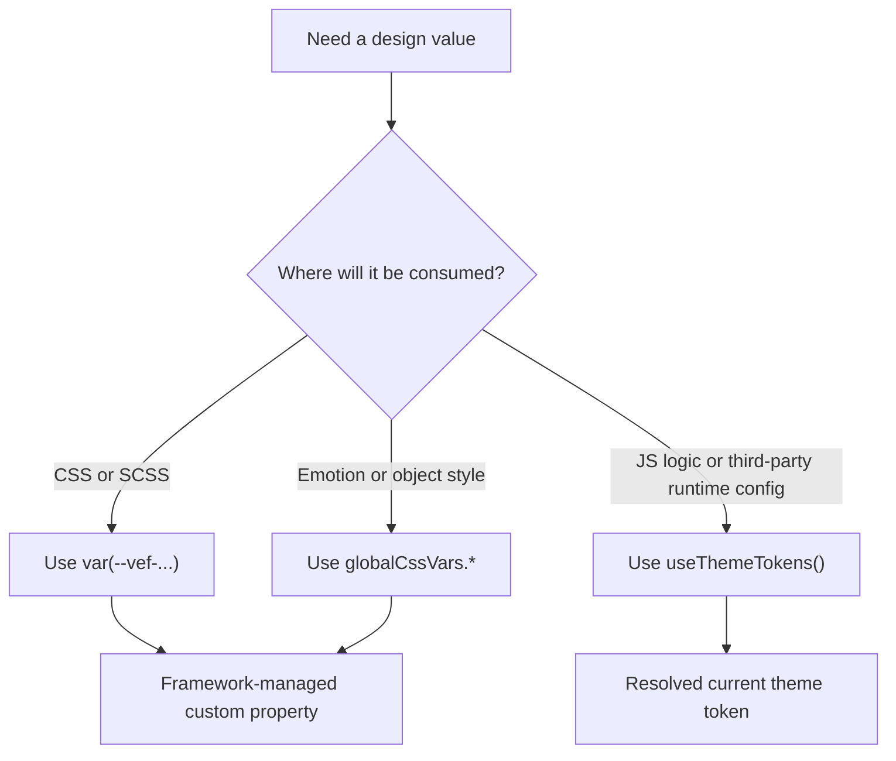

# 主题与样式

VEF 的主题能力主要由 `@vef-framework-react/components` 提供，当应用通过 `createApp()` 完成启动后，它们就已经接好了。

:::tip
如果你的应用是通过 `starter.createApp().render()` 启动的，CSS 自定义属性已经被注入到 `:root` 上。如果你手动挂载组件层，请保留 `@vef-framework-react/components` 的 [`ConfigProvider`](../components/config-provider.md)，这样全局变量才会被正确输出。
:::

## 常用 API

- `globalCssVars`
- `useThemeTokens`
- `useIsDarkMode`
- `colors`
- `semanticColors`
- `semanticScenes`

## 选择合适的入口

VEF 通过三条不同的访问路径暴露同一套设计语言，选择哪一条取决于这个值将在哪里被消费：

- 在 CSS Modules、SCSS、第三方样式表覆盖或 MDX 片段中，使用原生 CSS 变量，例如 `var(--vef-color-primary)`。
- 在 Emotion 及其它 JS 对象样式中，使用 `globalCssVars`，这样就不用重复书写字符串字面量，也能拿到同一个 token。
- 当一个值必须在 JavaScript 逻辑中被消费，或者需要传给某个在渲染时期望拿到已解析颜色/尺寸值的库时，使用 `useThemeTokens()`。



这里的关键区别在于：`globalCssVars` 返回的仍然是 CSS 变量字符串，而 `useThemeTokens()` 返回的是已解析的主题值。

### 推荐用法

| 需求 | 优先使用 | 原因 |
| --- | --- | --- |
| 页面间距、卡片内边距和区块节奏 | `--vef-spacing-*`、`--vef-padding-*`、`--vef-margin-*` | 保持布局节奏与框架组件一致。 |
| 主操作、链接和选中状态 | `--vef-color-primary`、`--vef-color-primary-hover`、`--vef-color-primary-active`、`--vef-color-primary-text` | 与主题覆盖和暗色模式行为保持一致。 |
| 中性面板、卡片和页面外壳 | `--vef-color-bg-container`、`--vef-color-bg-layout`、`--vef-color-border`、`--vef-shadow-*`、`--vef-border-radius*` | 与框架外壳和默认组件表面保持一致。 |
| 弱化、次要和描述性文本 | `--vef-color-text`、`--vef-color-text-secondary`、`--vef-color-text-tertiary`、`--vef-color-text-description` | 避免临时调整透明度，保持对比度一致。 |
| 校验和状态提示 | `--vef-color-success-*`、`--vef-color-warning-*`、`--vef-color-error-*`、`--vef-color-info-*` | 开箱即用地提供匹配的背景、边框和文字状态。 |
| 图表、插画和多色点缀 | `--vef-color-blue-50..950`、`--vef-color-emerald-50..950`，或预置的 `--vef-blue-1..10` 系列 | 提供比语义状态 token 更宽的色阶。 |
| 用 TS/JS 编写的 CSS-in-JS 样式 | `globalCssVars.*` | 避免在 Emotion 对象中重复书写原生的 `var(--vef-...)` 字符串。 |

## 原生 CSS 变量用法

当样式直接写在 CSS、SCSS 或 CSS Module 中时，使用原生变量：

```scss
.configItem {
  display: flex;
  gap: var(--vef-spacing-xl);
  padding: var(--vef-spacing-lg) var(--vef-spacing-xl);
  background: var(--vef-color-bg-container);
  border: 1px solid var(--vef-color-border-secondary);
  border-radius: var(--vef-border-radius-lg);
  box-shadow: var(--vef-shadow-sm);
}

.configItem:hover {
  background: var(--vef-color-fill-quaternary);
}
```

对于页面路由使用的 CSS Module、用来重新设计框架组件样式的 SCSS 文件，以及为不认识 `globalCssVars` 的第三方组件编写的 CSS，这是最好的默认选择。

## 在 Emotion 或对象样式中使用 `globalCssVars`

`globalCssVars` 是 `@vef-framework-react/components` 导出的 JS/TS 别名层。它把 CSS 变量名映射成驼峰命名字段，例如：

| CSS 自定义属性 | JS 别名 |
| --- | --- |
| `var(--vef-color-primary)` | `globalCssVars.colorPrimary` |
| `var(--vef-spacing-md)` | `globalCssVars.spacingMd` |
| `var(--vef-border-radius-lg)` | `globalCssVars.borderRadiusLg` |
| `var(--vef-font-family-code)` | `globalCssVars.fontFamilyCode` |

```tsx
import { css } from "@emotion/react";
import { globalCssVars } from "@vef-framework-react/components";

const panelStyle = css({
  padding: globalCssVars.spacingMd,
  borderRadius: globalCssVars.borderRadiusLg,
  border: `1px solid ${globalCssVars.colorBorderSecondary}`,
  backgroundColor: globalCssVars.colorBgContainer,
  boxShadow: globalCssVars.shadowSm
});
```

当样式已经写在 TS 或 JS 中时使用它。它能让 token 名称与框架保持一致，同时避免重复书写原生字符串。

## `useThemeTokens()` 用于运行时的值

`useThemeTokens()` 返回当前主题下已解析的 Ant Design token 对象。当某个运行时库需要具体的值而不是 CSS 变量字符串时，使用它：

```tsx
import { useThemeTokens } from "@vef-framework-react/components";

export function MetricsChart() {
  const { colorPrimary, colorTextSecondary } = useThemeTokens();

  return (
    <MyChart
      palette={[colorPrimary, colorTextSecondary]}
    />
  );
}
```

典型场景：动态着色、图标和插画配色、自定义卡片背景，以及需要已解析运行时值的图表或 canvas 配置。

## 暗色模式检测

```tsx
import { useIsDarkMode } from "@vef-framework-react/components";

const isDarkMode = useIsDarkMode();
```

当一个页面确实需要在暗色模式下使用不同的渐变、阴影或插画处理方式时，使用它。许多常用的颜色变量已经能够自动适配，所以只有在基于变量的方式无法表达这种差异时，才需要用到 `useIsDarkMode()`。

## 命名规则

一旦理清了变量家族，整个变量目录就更容易查阅了：

- `--vef-color-primary-*`、`--vef-color-success-*` 以及类似的语义色阶，是以含义驱动的样式的首选。
- `--vef-color-blue-*`、`--vef-color-emerald-*` 以及其它扩展色阶，适合需要一个具名颜色家族而不是语义意图的场景。
- `--vef-blue-1..10`、`--vef-purple-1..10` 以及类似的预置色阶，沿用了 Ant Design 风格的调色板编号。
- `--vef-color-text*`、`--vef-color-bg*`、`--vef-color-fill*` 和 `--vef-color-border*` 是中性的 UI 表面 token。
- `--vef-spacing-*`、`--vef-padding-*`、`--vef-margin-*`、`--vef-border-radius*` 和 `--vef-shadow-*` 是布局与层次的基础元素。

:::info
像 `--vef-card-body-padding` 这样的组件级覆盖变量，在组件文档中说明了的情况下依然有效，但它们不属于共享的全局 token 目录。
:::

## 为什么优先使用框架 token

语义色和 CSS 变量通常优于硬编码的颜色值，因为切换主题所需的覆盖更少，视觉语言与组件体系保持一致，后续的主题变更成本更低，页面样式也能与框架组件保持一致。

## 实践指导

在页面这一层，一个不错的默认做法是：

- 用组件表达布局
- 用 token 或语义色表达视觉值
- 只有在页面确实需要时，才使用大段硬编码样式
- 优先使用语义 token，其次是预置调色板，最后才是硬编码值

完整的、自动生成的 CSS 自定义属性目录——每个变量名及其默认值——见 [CSS 变量参考](../reference/css-variables-reference.mdx)。
