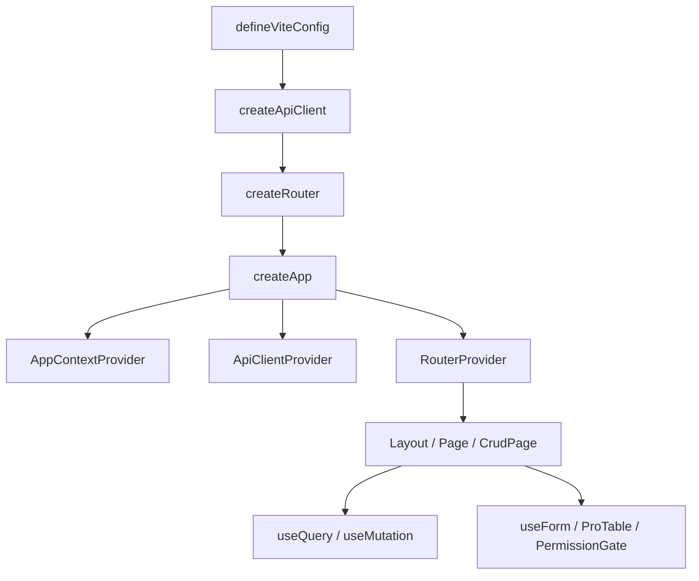

# VEF Framework React

VEF Framework React 是一套面向内部平台、后台系统和其他企业级应用的 React 解决方案。它不只是一个组件库或脚手架，而是把应用启动、路由、API 集成、权限、CRUD 页面、表单、状态管理、可视化 Schema 编辑器和 UI 构建块，统一到同一套 API 之下。

本文档只聚焦一件事: **如何使用框架导出的 API 构建应用**。  
仓库中还附带了一个示例应用 `playground`，可以作为应用结构和页面组合方式的参考。

## 为什么选择 VEF

大多数后台风格的前端项目，在每个项目里都会重复解决同一批问题: 接入鉴权和 token 刷新、搭建"搜索-表格-表单"式的 CRUD 页面、渲染权限感知的 UI、保持表单的一致性。VEF 把这些问题标准化为可导出的 API（`CrudPage`、`createCrudKit`、`useForm`、`ApiClient`、`PermissionGate` 等等），而不是让每个项目各自重新发明一遍。

当应用代码按**页面场景**组织，而不是按 `components`、`hooks`、`services` 这类大而全的共享目录组织时，VEF 的效果也最好。页面内的查询、表单和表格列定义留在页面附近；只有真正跨页面复用的代码才会被提升到共享位置。[项目结构](./getting-started/project-structure.md)和[项目规范](./advanced/project-conventions.md)对此有详细说明。

## 包总览

VEF 在 `@vef-framework-react/*` 作用域下发布了 9 个包。其中 6 个构成应用运行时和 UI；另外 3 个是可以嵌入宿主应用的可视化、Schema 驱动的编辑器。

| 包 | 你什么时候会用它 | 常见导出 |
| --- | --- | --- |
| `@vef-framework-react/starter` | 应用启动、路由、登录页和布局 | `createApp`、`createRouter`、`createApiClient`、`createRootRouteOptions`、`createLayoutRouteOptions` |
| `@vef-framework-react/components` | 页面 UI、页面容器、CRUD 页面、表单、表格、消息通知、图标和图表 | `Button`、`Page`、`CrudPage`、`createCrudKit`、`ProTable`、`Table`、`FormModal`、`FormDrawer`、`useForm`、`PermissionGate`、`Chart` |
| `@vef-framework-react/core` | 请求、query、store、atom、权限判断和 SSE | `ApiClient`、`useQuery`、`useMutation`、`createStore`、`createComponentStore`、`atom` |
| `@vef-framework-react/hooks` | 页面级辅助 hooks | `useDictionaryQuery`、`useHasMutating`、`useAuthorizedItems`、`useDebouncedValue` |
| `@vef-framework-react/shared` | 通用类型、校验、格式化、树形工具和事件发射器 | `z`、`EventEmitter`、`formatDate`、`flattenTree`、`withPinyin` |
| `@vef-framework-react/dev` | Vite、ESLint、Stylelint 和 Commitlint 配置 | `defineViteConfig`、`defineEslintConfig`、`defineStylelintConfig`、`defineCommitlintConfig` |
| `@vef-framework-react/form-editor` | 面向数百个字段的可视化、Schema 驱动表单设计器 | `FormEditor`、`FormRenderer`、`FormEditorProvider` |
| `@vef-framework-react/approval-flow-editor` | 基于 `@xyflow/react` + elkjs 自动布局构建的可视化审批流设计器 | `ApprovalFlowEditor`、`toFlowDefinition`、`fromFlowDefinition` |
| `@vef-framework-react/approval-form-bridge` | 将 form-editor 的 Schema 投影为后端审批表单契约 | `projectFormSchema`、`createApprovalRegistries`、`validateApprovalSchema` |

这三个编辑器包彼此独立——宿主应用既可以只嵌入 `form-editor`，也可以只嵌入 `approval-flow-editor`，或者两者一起嵌入，并由 `approval-form-bridge` 充当它们之间的投影层。

## 本文档的组织方式

侧边栏共有 6 个部分:

1. **快速上手** —— 一条线性教程。安装框架、运行一个最小应用，然后构建一个真实的 CRUD 页面。
2. **指南** —— 面向任务的"如何做 X"类型的叙述型文档（路由、数据请求、表单、表格、CRUD、状态、鉴权、权限、数据字典、主题、错误处理、hooks），按照从基础到进阶的顺序排列。
3. **组件** —— 每个导出组件的系统化参考，附带属性表和示例。按需查阅即可，不需要从头读到尾。
4. **可视化编辑器** —— form-editor、approval-flow-editor 和 approval-form-bridge 三个包:它们是什么、如何嵌入宿主应用，以及它们的 Schema/类型参考。
5. **API 参考** —— 简洁的逐包导出签名说明。当你已经明确知道要找什么时再来这里。
6. **进阶** —— 扩展点、性能习惯、测试建议和项目治理规范，适合在熟悉基础用法之后阅读。

指南负责叙述和"为什么"。组件负责属性表。API 参考负责精确签名。如果同一个概念在多处重复出现，那就是一个问题——指南应该链接到对应的组件或参考页面，而不是重复一遍。

## 阅读路径

对首次阅读者来说，按以下顺序阅读能循序渐进地建立理解:

1. **快速上手**，按顺序:
   1. [安装](./getting-started/installation.md)
   2. [快速开始](./getting-started/quick-start.md)
   3. [你的第一个 CRUD 页面](./getting-started/first-crud-page.md)
   4. [工程配置](./getting-started/configuration.md)
   5. [项目结构](./getting-started/project-structure.md)
2. **指南**，按顺序——每一篇都建立在前一篇的概念之上:
   1. [路由与布局](./guide/routing.md)
   2. [数据请求](./guide/data-fetching.md)
   3. [表单](./guide/forms.md)
   4. [表格](./guide/tables.md)
   5. [CRUD 页面](./guide/crud.md)
   6. [状态管理](./guide/state-management.md)
   7. [身份认证](./guide/authentication.md)
   8. [权限](./guide/permissions.md)
   9. [数据字典](./guide/data-dictionaries.md)
   10. [主题](./guide/theming.md)
   11. [错误处理](./guide/error-handling.md)
   12. [Hooks](./guide/hooks.md)
3. **组件** —— 从这里开始，把文档当作参考资料而不是线性阅读的教程。当页面需要某个具体的构建块时，打开[组件目录](./components/overview.md)查阅。
4. **可视化编辑器** —— 仅当应用需要嵌入表单设计器或审批流设计器时，才需要阅读[总览](./editors/overview.md)。
5. **API 参考** —— 需要精确的导出签名时，从[包总览](./reference/overview.md)开始查找。
6. **进阶** —— 在熟悉了日常工作流之后，阅读[项目规范](./advanced/project-conventions.md)、[自定义表单组件](./advanced/custom-form-components.md)、[性能](./advanced/performance.md)和[测试](./advanced/testing.md)。

## 典型应用组合方式

在大多数项目中，应用的搭建流程是这样的:

1. 使用 `@vef-framework-react/dev` 建立构建和代码检查的基线。
2. 使用 `@vef-framework-react/starter` 组装应用入口、路由和布局。
3. 使用 `@vef-framework-react/core` 定义请求函数、状态容器和 query 逻辑。
4. 使用 `@vef-framework-react/components` 和 `@vef-framework-react/hooks` 构建页面。
5. 使用 `@vef-framework-react/shared` 处理校验、格式化和数据转换。
6. 按需嵌入 `form-editor` 和/或 `approval-flow-editor`（由 `approval-form-bridge` 桥接），为应用提供 Schema 驱动的设计能力。

## 示例应用参考点

示例应用（`playground`）包含以下代表性示例:

- `src/main.ts` —— `createApp().render()` 的入口
- `src/api/index.ts` —— 标准的 `createApiClient()` 配置
- `src/pages/__root.ts` —— 使用 `createRootRouteOptions()` 的根路由设置
- `src/pages/_layout/route.tsx` —— 使用 `createLayoutRouteOptions()` 的布局和守卫设置
- `src/pages/_layout/auth/user/route.tsx` —— 一个典型的 `CrudPage` 实现
- `src/pages/_layout/auth/user/components/form.tsx` —— 一个典型的 `useFormContext()` + `AppField` 表单
- `src/pages/_layout/sys/form-editor/route.tsx` —— 表单编辑器的宿主集成方式
- `src/pages/_layout/sys/approval-flow-editor/route.tsx` —— 审批流编辑器的宿主集成方式
- `src/pages/_layout/sys/flow-designer-wizard/` —— `approval-form-bridge` 将 form-editor 的 Schema 投影为审批流

## 文档说明

- 示例代码基于当前公开的 API 表面，并遵循与示例应用相同的结构模式。
- 除非另有说明，示例只使用框架公开导出的 API。
- 本文档关注的是如何在应用代码中组合这些 API，而不是内部实现细节。
